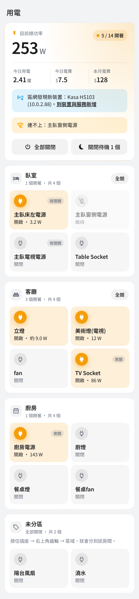
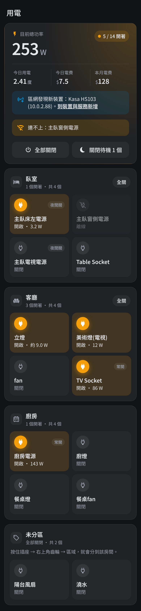

# homecontrol

> **不想用 Home Assistant？** [`app/`](app/README.md) 是自己開發的插座 App：樹莓派上一個小伺服器加手機網頁 App，直接在區網控制插座，功能和下面的儀表板一樣。

家裡智慧插座的電源管理：用樹莓派跑 Home Assistant，**自動偵測區網裡的插座**，在區域網路內直接控制、記錄用電、估算電費，手機（Android／iPhone）上用自動產生的儀表板操作，有新裝置、待機、功率過高和斷線的通知。

```
手機（Home Assistant App，在外面時透過 Tailscale 連回家裡）
   │
   ▼
Raspberry Pi 5：Home Assistant OS ──每天備份──→ NAS
   │  區域網路：自動發現新裝置
   ▼
Tapo P110 / Kasa KP115（有計量）、Kasa HS103 / HS105 / HS107 / KP303（只有開關）、其他品牌
（原本的 Google Home 語音照樣能用）
```

## 運作方式

1. **發現**：Home Assistant 用 DHCP 和廣播偵測區網上的裝置。發現還沒加入的裝置時，手機會收到「區網發現新裝置」通知，儀表板最上面也會出現提示，點一下就到新增頁面。
2. **加入**：新增時按一次確認（Home Assistant 規定新裝置要由人確認，避免陌生裝置自己接進系統）。TP-Link 帳號只要第一次輸入。
3. **自動納入**：加入後 `power_hub` 會自動把它算進總功率、用電、電費、斷線偵測和「全部關閉」，儀表板也會自動多出它的開關。手機收到「插座已加入」通知，點一下就能到它的裝置頁；也可以直接在儀表板上點插座的「⋯」設定。
4. **在手機上設定**：區域和標籤都在 Home Assistant App 裡點選，不用改任何檔案。

`power_hub` 判斷規則：

| 項目 | 規則 |
| --- | --- |
| 什麼算插座 | 任何品牌、屬於某個裝置的主要開關。LED、童鎖、自動關閉這類設定開關不算；網路設備（路由器、NAS 等）的開關不算 |
| 有沒有計量 | 同一個裝置底下有功率感測器就算有計量，不看名稱 |
| 多孔排插（HS107、KP303） | 每一孔各算一個插座；「整排」那個開關不算，免得「全部關閉」連常開的那一孔一起關 |
| 用電累計 | 只加每個插座累計值的「增加量」：新插座加入、斷線、感測器歸零都不會讓總用電亂跳，斷線期間用的電恢復後也會補算 |

## 插座設定

**都在儀表板上點選就好**：點插座右上角的「⋯」，可以改名稱、選房間（或直接新增房間）、打開「常開」「夜間關閉」、填上大約耗電幾瓦。改了就生效，不用進 Home Assistant 的設定畫面。

儀表板其實是把這些設定存成 Home Assistant 的區域和標籤，所以也可以在 Home Assistant 裡手動貼標籤，效果一樣：

| 標籤 | 作用 |
| --- | --- |
| `常開` | 冰箱、網路設備等：所有關閉動作都會跳過 |
| `夜間關閉` | 夜間排程要關掉的插座 |
| `9W`（任何瓦數） | 沒有計量的插座：用這個瓦數估算用電（開著的時間 × 瓦數），算進總功率、用電和電費 |
| `不管理` | 完全不納入，例如不想被「全部關閉」關到的特殊開關 |

房間就是 Home Assistant 的「區域」。換房間有三種方式：

- **拖拉**：把插座拖到別的房間。電腦用滑鼠直接拖；手機上按住插座一下再拖（直接滑動是捲動畫面）。拖到最下面「拖到這裡，建立新房間」會請你輸入新房間名稱
- **整理房間**：按「房間」旁邊的「整理房間」，手機上不用按住就能直接拖，所有房間（包括空的）都會列出來，弄完按「完成」
- **分配房間**：還沒分房間的插座會排在最上面，按「分配房間」會一個一個問你插座在哪個房間，點一下就換下一個

點房間名稱可以改名或刪除房間。

**自訂排序**：把插座拖到另一個插座的左半邊就排在它前面，右半邊就排在它後面（同一個房間裡調順序，或換房間時直接放到想要的位置）。整理模式下，拉房間右上角的把手可以調整房間的先後。順序存在 `power_hub` 裡，手機和電腦看到的一樣；還沒排過的照名稱排在後面。

## 檔案

| 檔案 | 內容 |
| --- | --- |
| `custom_components/power_hub/` | 自動偵測插座、累計用電、斷線／待機／功率過高／新發現裝置的感測器、關閉與還原插座的動作 |
| `www/power-dashboard.js` | 自動產生的手機儀表板：總覽和各房間插座的卡片（`power-hub-card`），加上圖表、排程、設定；新插座自動出現 |
| `dashboards/power.yaml` | 儀表板設定（只有一行，指向上面的產生器） |
| `packages/power.yaml` | 台電累進電價、門檻、今日／本月用電與電費、通知 |
| `packages/power_automations.yaml` | 區網發現新裝置、插座已加入、23:00 待機提醒、功率過高、插座斷線 |
| `packages/power_schedule.yaml` | 夜間排程：晚上關閉、早上打開 |

## 畫面

以下是用模擬的 TP-Link 插座截的手機畫面（iPhone 尺寸），整個版面都是自動產生的。左邊是整頁，右邊是點插座「⋯」打開的設定面板（深色模式）：

<p>
  
  
</p>

由上到下：

- **總覽**：目前總功率、開著幾個、今日用電、今日和本月電費；區網發現新裝置、插座連不上超過 10 分鐘時會出現提示。沒有任何計量或估算的插座時，大字改成顯示「開著幾個」
- **全部關閉／關閉待機**：按一次就關，下面會出現「已關閉 N 個插座［復原］」，按錯了點「復原」就會打開剛剛關掉的那些
- **各房間**：一個房間一張卡片，右上角「全關」關掉整個房間。插座開著是橘色、關著是灰色、離線變淡；**點插座開關，點右上角「⋯」設定，拖拉換房間**。「常開」「夜間關」會標在插座下面
- 有計量的插座才有：近 14 天每日用電、近 24 小時功率
- **夜間排程**：開關、晚上關閉和早上打開的時間（手機的時間選擇器），要關哪些插座直接點選
- **電費與提醒**：家裡每月用電、目前電價、待機門檻、功率過高提醒，用 − / + 調整

多孔排插（HS107、KP303）的每一孔，如果整台排插沒改過名稱，就只顯示孔的名稱，例如「餐桌燈」，不會帶出 `TP-LINK_Smart Plug_C599` 這種出廠名稱。

## 需要準備

- Raspberry Pi 5（建議 4GB 以上）、官方 27W 電源供應器、官方 Active Cooler
- USB 或 M.2 的 SSD（比 SD 卡耐用；只用 SD 卡請選 A2 等級）
- 網路線
- 路由器上把樹莓派設成固定 IP（DHCP 保留）；插座也設固定 IP 會更穩定

## 安裝

### 1. 插座開啟第三方相容性

新版韌體沒開的話，Home Assistant 可能連不上。

- Tapo App：我 → Tapo Lab → 第三方相容性（Third-Party Compatibility）
- Kasa App：設定 → 第三方相容性

### 2. 安裝 Home Assistant OS

1. 電腦上開 Raspberry Pi Imager：Raspberry Pi 5 → Other specific-purpose OS → Home assistants and home automation → Home Assistant OS，寫入 SSD 或 SD 卡
2. 樹莓派接網路線開機，幾分鐘後開 `http://homeassistant.local:8123` 建立帳號
3. 地區選台灣、時區 Asia/Taipei、貨幣 TWD

### 3. 放入檔案

1. 附加元件商店安裝「Studio Code Server」或「File editor」（也可以用「Samba share」從電腦複製）
2. 把這三個資料夾複製到 `/config/` 底下：`custom_components/`、`www/`、`packages/`
3. 打開 `/config/configuration.yaml`，加入（已經有 `homeassistant:` 或 `frontend:` 的話，把裡面那行加進去）：

   ```yaml
   homeassistant:
     packages: !include_dir_named packages

   frontend:
     extra_module_url:
       - /local/power-dashboard.js?v=6

   power_hub:
   ```

4. 開發者工具 → YAML → 「檢查設定」，沒有錯誤再按「重新啟動」

### 4. 加入插座

1. 設定 → 裝置與服務：區網上的 TP-Link 插座通常已經出現在「已發現」，按「新增」，用 TP-Link 帳號登入（Tapo 和 Kasa 是同一組帳號）
2. 其他插座照樣按「新增」；之後區網再出現新裝置，手機會收到通知
3. 打開「用電」儀表板，按「分配房間」把插座分到各房間；要常開、夜間關閉、估算瓦數的，點插座右上角的「⋯」設定

名稱用中文就可以，不需要改成英文。

更新 `www/power-dashboard.js` 之後，把 `configuration.yaml` 裡的 `?v=6` 改成下一個數字（`?v=7`）再重新啟動，手機和瀏覽器才不會繼續用舊的快取。

### 5. 設定電價與門檻

儀表板最下面的「電費與提醒」：

| 項目 | 建議值 |
| --- | --- |
| 家裡每月用電 | 電費單上的度數；兩個月抄表一次的話除以 2。用來判斷你家落在台電累進電價的哪一級 |
| 待機門檻 | 5 W：插座開著、但低於這個值就當作電器在待機（預設是 0.5 W，請記得改） |
| 功率過高門檻 | 1500 W：110V 插座一般 15A，持續超過 1500 W 就提醒 |

「目前電價」會依每月用電和夏月（6–9 月）／非夏月自動算出來。

### 6. 手機

1. 安裝 Home Assistant App（Android／iOS），登入後允許通知
2. 開發者工具 → 動作，搜尋 `mobile_app`，找到手機的通知名稱，填進 `packages/power.yaml` 的 `power_notify`，取代 `notify.mobile_app_my_phone`，重新啟動
3. 設定 → 儀表板 → 新增儀表板 →「從頭開始」，命名「用電」→ 打開 → ⋮ → 編輯儀表板 → ⋮ →「原始設定編輯器」→ 貼上 `dashboards/power.yaml` 的內容並儲存
4. App 的設定 → 隨附應用程式 → 可以把「用電」設成預設儀表板

### 7. 能源儀表板

設定 → 儀表板 → 能源 → 個別裝置 → 加入各插座的累計用電感測器（TP-Link 是「總耗能」），就有內建的每日／每月用電圖表。

### 8. 在外面時連回家裡

1. 附加元件商店安裝「Tailscale」並啟動、登入
2. 手機安裝 Tailscale App，用同一個帳號登入
3. Home Assistant App 的伺服器網址加上 Tailscale 給樹莓派的位址（`http://100.x.x.x:8123`）

不需要在路由器上開放任何連接埠。

### 9. 備份到 NAS

1. NAS 上開一個共用資料夾，啟用 SMB
2. Home Assistant：設定 → 系統 → 儲存 → 新增網路儲存，用途選「備份」
3. 設定 → 系統 → 備份 → 自動備份，位置選 NAS，每天備份

樹莓派壞了的話，重新安裝 Home Assistant OS 後，從 NAS 上的備份就能完整還原。

## 插座型號

| 型號 | 插座數 | 用電計量 | 在這份設定裡 |
| --- | --- | --- | --- |
| Tapo P110 | 1 | 有 | 開關、功率、用電、電費、待機與功率過高通知 |
| Kasa KP115 | 1 | 有 | 同上 |
| Kasa HS103、HS105 | 1 | 無 | 開關；貼瓦數標籤可估算用電 |
| Kasa HS107 | 2 | 無 | 每一孔各一個開關 |
| Kasa KP303 | 3（另有 USB） | 無 | 每一孔各一個開關；USB 不能個別控制 |

其他品牌只要 Home Assistant 支援、而且是開關，也會自動納入。

## 電價

`packages/power.yaml` 的 `Power Price` 裡有一張台電住宅用非時間電價（累進）表，目前是 2025 年 10 月 1 日起的費率：

| 每月度數 | 夏月（6–9 月） | 非夏月 |
| --- | --- | --- |
| 120 以下 | 1.78 | 1.78 |
| 121–330 | 2.55 | 2.26 |
| 331–500 | 3.80 | 3.13 |
| 501–700 | 5.14 | 4.24 |
| 701–1000 | 6.44 | 5.27 |
| 1001 以上 | 8.86 | 7.03 |

電費是用「你家每月用電落在哪一級」的單價計算：插座省下來的電，是從最高的那一級扣掉的，所以這樣算最接近關掉插座能省多少錢。台電調整電價時，照電費單或台電網站改這張表。

## 夜間排程

儀表板「夜間排程」打開後，每天「晚上關閉」的時間會關掉貼了 `夜間關閉` 標籤、而且開著的插座；「早上打開」的時間只會打開晚上被排程關掉的那些：晚上本來就關著的，或半夜你自己又關掉的，都不會被打開。貼了 `常開` 的永遠不會被關。

## 通知

| 通知 | 時機 | 點通知 |
| --- | --- | --- |
| 區網發現新裝置 | Home Assistant 在區網上發現還沒加入的裝置 | 到「裝置與服務」新增 |
| 插座已加入 | 新的插座加入、被 `power_hub` 納入 | 到它的裝置頁設定區域和標籤 |
| 有插座在待機 | 每天 23:00，有計量插座開著但功率在 0.2 W 和待機門檻之間 | 通知上的「全部關閉」關掉這些插座（常開除外） |
| 插座功率過高 | 任何一個計量插座超過門檻持續 1 分鐘 | — |
| 插座連不上 | 有插座斷線超過 10 分鐘；全部恢復時會再通知一次 | — |

提醒時間改 `packages/power_automations.yaml` 裡的 `at: "23:00:00"`。

## 給進階使用者

`power_hub` 提供的感測器和動作，可以用在自己的自動化裡：

| 實體／動作 | 內容 |
| --- | --- |
| `sensor.plugs_power` | 插座總功率（W），有計量的實際值加上估算值 |
| `sensor.plugs_energy_total` | 插座累計用電（kWh），只增不減 |
| `sensor.plugs_offline`、`sensor.plugs_standby`、`sensor.plugs_overload`、`sensor.plugs_discovered` | 數量；名稱在 `names` 屬性 |
| `sensor.plugs_managed` | 偵測到的插座數量；完整清單（區域、計量方式、標籤）在 `plugs` 屬性 |
| `power_hub.turn_off` | 關閉插座，可以指定 `area`、`label`、`standby_only`；`remember` 記住關了哪些 |
| `power_hub.restore` | 打開 `remember` 記住、而且還關著的插座 |
| `power_hub.rescan` | 立刻重新偵測（平常裝置、區域、標籤一有變動就會自動重新偵測） |
| `power_hub.set_order` | 記住插座（`plugs`：實體 ID 清單）和房間（`areas`：區域 ID 清單）的順序，儀表板拖拉排序時會呼叫 |
