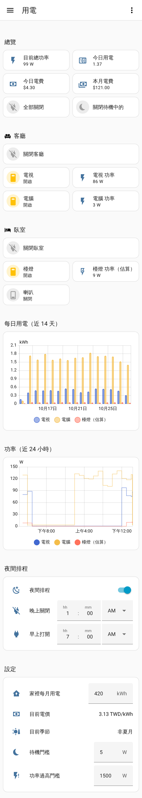
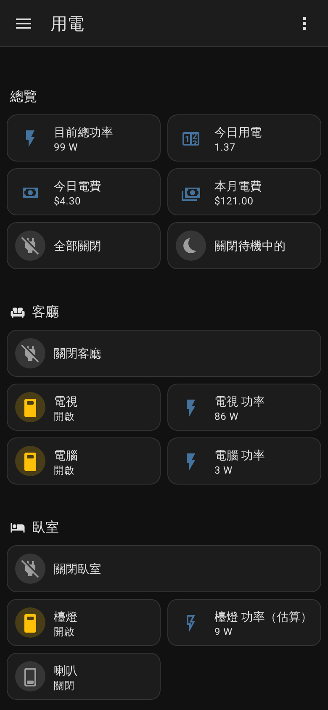

# homecontrol

家裡 TP-Link Tapo／Kasa 插座的電源管理：用樹莓派跑 Home Assistant，在區域網路內直接控制插座、記錄用電、估算電費，手機（Android／iPhone）上用自訂儀表板操作，有待機與功率過高的通知。

```
手機（Home Assistant App，在外面時透過 Tailscale 連回家裡）
   │
   ▼
Raspberry Pi 5：Home Assistant OS ──每天備份──→ NAS
   │  區域網路
   ▼
Tapo P110 / Kasa KP115（有計量）、Kasa HS103 / HS105 / HS107 / KP303（只有開關）
（原本的 Google Home 語音照樣能用）
```

## 檔案

| 檔案 | 內容 |
| --- | --- |
| `packages/power.yaml` | 插座清單與房間、台電累進電價、門檻、總功率、今日／本月用電與電費、斷線偵測、關閉插座的腳本、通知 |
| `packages/power_automations.yaml` | 每天 23:00 待機提醒（通知上可一鍵關閉）、功率過高警告、插座斷線通知 |
| `packages/power_estimated.yaml` | 沒有計量的插座用固定瓦數估算用電 |
| `packages/power_schedule.yaml` | 夜間排程：晚上關閉、早上打開 |
| `dashboards/power.yaml` | 手機用電儀表板 |

## 畫面

以下是用假資料截的手機畫面（iPhone 尺寸），左邊是整頁，右邊是深色模式：

<p>
  
  
</p>

由上到下：總覽（總功率、今日用電、電費、全部關閉、關閉待機中的）→ 各房間（關閉整區、每個插座的開關和功率）→ 近 14 天每日用電 → 近 24 小時功率 → 夜間排程 → 設定。有插座連不上超過 10 分鐘時，總覽最上面會出現警告。

## 插座型號

| 型號 | 插座數 | 用電計量 | 在這份設定裡 |
| --- | --- | --- | --- |
| Tapo P110 | 1 | 有 | 開關、功率、用電、電費、待機與功率過高通知 |
| Kasa KP115 | 1 | 有 | 同上 |
| Kasa HS103、HS105 | 1 | 無 | 只有開關，包含在「全部關閉」 |
| Kasa HS107 | 2 | 無 | 每個插座各一個開關 |
| Kasa KP303 | 3（另有 USB） | 無 | 每個插座各一個開關；USB 不能個別控制 |

## 需要準備

- Raspberry Pi 5（建議 4GB 以上）、官方 27W 電源供應器、官方 Active Cooler
- USB 或 M.2 的 SSD（比 SD 卡耐用；只用 SD 卡請選 A2 等級）
- 網路線
- 路由器上把樹莓派和每個插座設成固定 IP（DHCP 保留）

## 安裝

### 1. 插座開啟第三方相容性

新版韌體沒開的話，Home Assistant 可能連不上。

- Tapo App：我 → Tapo Lab → 第三方相容性（Third-Party Compatibility）
- Kasa App：設定 → 第三方相容性

### 2. 安裝 Home Assistant OS

1. 電腦上開 Raspberry Pi Imager：Raspberry Pi 5 → Other specific-purpose OS → Home assistants and home automation → Home Assistant OS，寫入 SSD 或 SD 卡
2. 樹莓派接網路線開機，幾分鐘後開 `http://homeassistant.local:8123` 建立帳號
3. 地區選台灣、時區 Asia/Taipei、貨幣 TWD

### 3. 加入插座並改名

1. 設定 → 裝置與服務：通常會自動找到「TP-Link Smart Home」，用 TP-Link 帳號登入（Tapo 和 Kasa 是同一組帳號）
2. 每個插座的裝置頁 → 右上角鉛筆 → 名稱改成**簡短英文**（例如 `tv`、`pc`），出現「要更新實體 ID 嗎」時選更新
3. 確認實體 ID 符合下面的規則（設定 → 實體，搜尋插座名稱）：

   | 用途 | 實體 ID |
   | --- | --- |
   | 開關 | `switch.tv` |
   | 即時功率（W） | `sensor.tv_current_consumption` |
   | 累計用電（kWh） | `sensor.tv_total_consumption` |

   沒有計量的插座（HS103、HS105、HS107、KP303）只會有開關，沒有這兩個感測器。

   HS107、KP303 這類多孔插座會有兩種開關：

   | 開關 | 實體 ID（排插叫 `desk`、兩個孔叫 `lamp`、`speaker` 時） |
   | --- | --- |
   | 整排（任一孔開著就是開，關掉會全部關） | `switch.desk` |
   | 每一孔 | `switch.desk_lamp`、`switch.desk_speaker` |

   每一孔的名稱來自 Kasa App 裡各孔的名稱，建議先在 Kasa App 把排插和各孔都改成英文再加入 Home Assistant；已經加入的話，到各孔開關的設定裡直接改實體 ID。設定檔裡請列**每一孔**的開關，不要列整排的開關，否則「全部關閉」會連常開的那一孔一起關掉。

   名稱對好之後，儀表板上顯示的中文名稱可以在儀表板裡另外設定。

### 4. 放入設定檔

1. 附加元件商店安裝「Studio Code Server」或「File editor」（也可以用「Samba share」從電腦複製）
2. 把 `packages/` 整個資料夾複製到 `/config/packages/`
3. 打開 `/config/configuration.yaml`，在最上面加入（已經有 `homeassistant:` 的話，把 `packages` 那行加進去）：

   ```yaml
   homeassistant:
     packages: !include_dir_named packages
   ```

4. 依照你家的插座修改 `packages/power.yaml`：
   - `power_plugs`：列出所有要管理的插座（包含沒有計量的），「全部關閉」用這份清單
   - `power_plugs_metered`：只列有計量的插座（P110、KP115）。總功率、用電、電費、待機和功率過高通知只看這份；沒計量的放進來會讓累計用電一直顯示無法使用
   - `power_plugs_estimated`：用固定瓦數估算用電的插座（見下面「估算沒有計量插座的用電」）
   - `room_living`、`room_bedroom`…：每個房間一個群組，名稱以 `room_` 開頭；儀表板每個房間一區
   - `power_plugs_night`：夜間排程要關掉的插座
   - `power_plugs_keep_on`：冰箱、網路設備等不能斷電的插座，例如：

     ```yaml
     power_plugs_keep_on:
       name: 常開插座
       entities:
         - switch.fridge
     ```

   - `power_notify` 裡的 `notify.mobile_app_my_phone`：換成你手機的通知名稱（第 6 步裝好手機 App 後，到開發者工具 → 動作，搜尋 `mobile_app`）
5. 開發者工具 → YAML → 「檢查設定」，沒有錯誤再按「重新啟動」

### 5. 設定電價與門檻

重新啟動後到設定 → 實體，或儀表板最下面的「設定」區塊：

| 項目 | 建議值 |
| --- | --- |
| 家裡每月用電 | 電費單上的度數；兩個月抄表一次的話除以 2。用來判斷你家落在台電累進電價的哪一級 |
| 待機門檻 | 5 W：插座開著、但低於這個值就當作電器在待機 |
| 功率過高門檻 | 1500 W：110V 插座一般 15A，持續超過 1500 W 就提醒 |

「目前電價」會依每月用電和夏月（6–9 月）／非夏月自動算出來，不用另外填。

### 6. 手機

1. 安裝 Home Assistant App（Android／iOS），登入後允許通知
2. 回到第 4 步，填好通知名稱並重新啟動
3. 設定 → 儀表板 → 新增儀表板 →「從頭開始」，命名「用電」→ 打開 → ⋮ → 編輯儀表板 → ⋮ →「原始設定編輯器」→ 貼上 `dashboards/power.yaml` 的內容並儲存
4. App 的設定 → 隨附應用程式 → 可以把「用電」設成預設儀表板

### 7. 能源儀表板

設定 → 儀表板 → 能源 → 個別裝置 → 把每個插座的 `*_total_consumption` 加進去，就有內建的每日／每月用電圖表。

### 8. 在外面時連回家裡

1. 附加元件商店安裝「Tailscale」並啟動、登入
2. 手機安裝 Tailscale App，用同一個帳號登入
3. Home Assistant App 的伺服器網址加上 Tailscale 給樹莓派的位址（`http://100.x.x.x:8123`）

不需要在路由器上開放任何連接埠。

### 9. 備份到 NAS

1. NAS 上開一個共用資料夾，啟用 SMB
2. Home Assistant：設定 → 系統 → 儲存 → 新增網路儲存，用途選「備份」
3. 設定 → 系統 → 備份 → 自動備份，位置選 NAS，每天備份

樹莓派壞了的話，重新安裝 Home Assistant OS 後，從 NAS 上的備份就能完整還原。

## 電價

`packages/power.yaml` 的 `Power Price` 裡有一張台電住宅用非時間電價（累進）表，目前是 2025 年 10 月 1 日起的費率：

| 每月度數 | 夏月（6–9 月） | 非夏月 |
| --- | --- | --- |
| 120 以下 | 1.78 | 1.78 |
| 121–330 | 2.55 | 2.26 |
| 331–500 | 3.80 | 3.13 |
| 501–700 | 5.14 | 4.24 |
| 701–1000 | 6.44 | 5.27 |
| 1001 以上 | 8.86 | 7.03 |

電費是用「你家每月用電落在哪一級」的單價計算：插座省下來的電，是從最高的那一級扣掉的，所以這樣算最接近關掉插座能省多少錢。台電調整電價時，照電費單或台電網站改這張表。

## 估算沒有計量插座的用電

HS103、HS105、HS107、KP303 量不到用電，可以給每個插座一個固定瓦數（看電器背後的標示，或用有計量的插座實際量一次），開著的時間乘上瓦數就是估算的用電：

1. 照 `packages/power_estimated.yaml` 裡 `lamp` 的樣子，為每個插座複製一組 template 感測器和 integration 感測器，改名稱、開關和瓦數
2. 把開關加進 `power.yaml` 的 `power_plugs_estimated`
3. 儀表板加上它的功率，兩張圖表也各加一組

估算的插座會算進總功率、用電和電費，但不會觸發待機提醒和功率過高警告。剛加入時要等幾分鐘累計用電才會有值，這段時間今日用電會暫時顯示無法使用。

## 夜間排程

儀表板「夜間排程」打開後，每天「晚上關閉」的時間會關掉 `power_plugs_night` 裡開著的插座，「早上打開」的時間只會打開晚上被排程關掉的那些：晚上本來就關著的，或半夜你自己又關掉的，都不會被打開。常開插座永遠不會被關。

## 新增插座

1. 照第 3 步加入並改成英文名稱
2. `packages/power.yaml` 的 `power_plugs` 加上新插座的開關；有計量的（P110、KP115）也加進 `power_plugs_metered`（總功率、用電、電費、通知都會自動包含它）
3. 開發者工具 → YAML → 重新載入「群組」
4. 加進它的房間群組（`room_…`），要夜間關閉的也加進 `power_plugs_night`
5. 儀表板在它的房間加開關；有計量或估算的再加功率，兩張圖表也各加一組

## 新增房間

1. `packages/power.yaml` 加一個群組，例如 `room_study`（名稱「書房」），列出這個房間的插座
2. 儀表板複製一個房間區塊，把 `group.room_living` 換成 `group.room_study`、`living_off` 換成 `study_off`，標題和插座也換掉

## 名稱和這份設定不一樣時

TP-Link 整合的功率和累計用電感測器，英文名稱是「Current consumption」「Total consumption」（繁體中文介面顯示為「目前耗能」「總耗能」）。介面設成繁體中文時，實體 ID 仍然用英文名稱產生，所以字尾一樣是 `_current_consumption`、`_total_consumption`。

最常見的不符是插座名稱用中文：例如裝置叫「電視」，實體 ID 會變成拼音 `sensor.dian_shi_current_consumption`。照第 3 步把裝置改成英文名稱並更新實體 ID 就好。

若還是不符，有兩個做法：

- 在每個感測器的設定裡把實體 ID 改成上面的規則（建議）
- 或是把 `packages/` 和 `dashboards/` 裡的這兩個字尾全部換成實際的名稱

## 通知

| 通知 | 時機 | 按鈕 |
| --- | --- | --- |
| 有插座在待機 | 每天 23:00，有計量插座開著但功率在 0.2 W 和待機門檻之間 | 「全部關閉」：關掉這些插座（常開插座除外） |
| 插座功率過高 | 任何一個計量插座超過門檻持續 1 分鐘 | 無 |
| 插座連不上 | 有插座斷線超過 10 分鐘；全部恢復時會再通知一次 | 無 |

提醒時間改 `packages/power_automations.yaml` 裡的 `at: "23:00:00"`。
