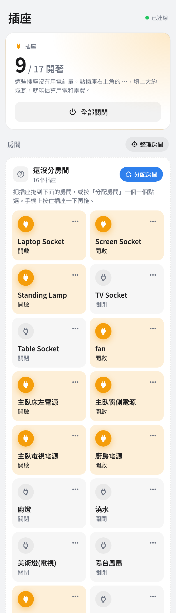
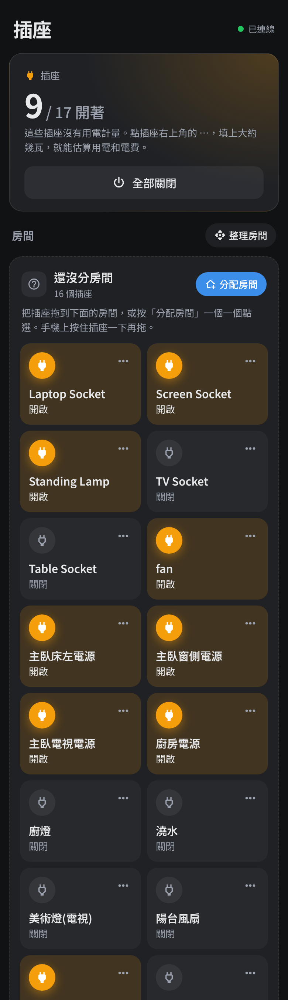

# 家庭中控 Home Hub（不用 Home Assistant）

樹莓派上的小伺服器加一個手機網頁 App，直接在區網控制 TP-Link Kasa／Tapo 插座：不用帳號、不經過雲端、不用 Home Assistant。

<p>
  
  
</p>

## 功能

- **自動找插座**：每分鐘在區網找一次，新插座自動出現；換了 IP 也會跟著更新。多孔排插（HS107、KP303）每一孔各算一個
- **畫面**：手機一欄、下方分頁列；平板兩欄；電腦左側選單、兩到三欄。分頁：首頁（我的家）／排程／用電／設定。支援深色模式
- **開關與裝置詳細**：每個裝置右邊的開關直接開關；點那一列打開「裝置詳細」看資訊、調整設定（不放開關）：定時關閉（開著時）、改名、房間、接的電器、常開、最長開啟時間、防呆、Google Home、插座本身的資訊。關著的裝置只顯示名稱；開著的寫「開了 2 小時」，開超過設定的時數（預設 6 小時）變橘色
- **情境**：插座頁最上面的按鈕，一次設定好多個插座（每個插座選「打開／關閉／不動」）。預設有「出門」「睡覺」「看電影」，在「編輯」裡可以改、新增、排順序
- **定時關閉**：在裝置詳細裡選常用時間，或「自訂時間」用滾輪設到秒，時間到自動關閉（有設 ntfy 也會通知）
- **最長開啟時間（防呆）**：澆水、電暖器這類開太久會出事的插座，在「編輯 → 點名稱」設定最長開多久（可以設到秒，例如 1 分 30 秒；有常用選項也能自己輸入時／分／秒）。不管從 App、Google Home、排程、情境還是插座上的按鈕打開，時間到一定關，不能取消；「整間打開」不會打開它；關不掉時用 ntfy 發緊急通知並一直重試。名稱有「澆水」「灑水」的插座第一次出現時預設 10 分鐘。另外會把關閉時間也寫進插座本身的倒數計時（比樹莓派晚 5 秒），樹莓派當機或斷電時插座也會自己關。定時關閉每秒檢查，誤差約 1 秒
- **全部關閉／整間關閉／整間打開**：按一次就執行，提示條上可以「復原」；執行情境也能復原。常開的插座不會被關。房間全部關著時，按鈕變成「整間打開」
- **編輯**：首頁右上角「編輯」：按住 ⠿ 拖拉調整裝置、房間、情境的順序，裝置可以直接拖到別的房間；點名稱打開裝置詳細
- **排程**：時間可以選「固定時間（到秒）」或「日出／日落」（可提早或延後幾分鐘；位置用插座裡存的經緯度，日出日落在樹莓派上計算，不上網）、哪幾天（每天／平日／週末／自選），要「關閉插座」「打開插座」或「執行情境」。關閉時可以設定之後幾點再打開（只開被它關掉的）；打開時可以設定開多久後自動關閉（例如澆水 50 秒，一筆排程就搞定）。時間用「時：分：秒」三個選單選。舊版的夜間排程會自動轉成一筆排程
- **插座本身的功能**（樹莓派離線也照樣運作）：
  - 排程寫進插座：插座規則只到分鐘，秒數往後取整。樹莓派在線時用「租約」：每條「打開」規則在執行前 2 分鐘暫停、過 1 分鐘再恢復，由樹莓派執行；樹莓派離線時才由插座執行。「關閉」規則一直保持啟用（樹莓派途中當掉也會關）。「之後再打開」不寫進插座
  - 定時關閉、最長開啟時間：也寫進插座本身的倒數，樹莓派停掉照樣會關
  - 離家模式（排程頁）：選的插座在指定時段由插座自己隨機開關
  - 裝置詳細裡：指示燈開關、Wi-Fi 訊號、插座自己記錄的使用時間、Kasa App 設的排程、TP-Link 雲端狀態、重新啟動
  - 網路與韌體：裝置詳細顯示 Wi-Fi 名稱、加密方式、韌體版本與是否有新版（每 12 小時向 TP-Link 雲端查一次，斷開雲端後無法檢查）；設定頁「網路與韌體檢查」會指出連到不同 Wi-Fi、加密比 WPA2 弱、有新韌體的插座
  - 離家模式卡片也列出 Kasa App 設的離家模式，可以直接啟用／停用、刪除
  - 設定頁可以斷開所有插座的 TP-Link 雲端（家庭中控和 Google Home 都不需要它）
  - 用 Kasa App 設在插座裡的排程也會讀出來，和家庭中控的排程放在同一個清單（依時間排、標「插座內建」）。可以直接開關、改時間／星期／動作、刪除（直接改插座裡的設定，Kasa App 也會看到）；也可以「轉換」成家庭中控的排程（停用的轉換後也停用）
  - 只管理自己寫的規則（用內容辨認，因為 KP303 等韌體不保存規則名稱），不動 Kasa App 設的
- **Wi-Fi 感測（實驗）**（設定頁）：每 2 秒讀每台插座的 Wi-Fi 訊號強度（只保留 1 小時，每 5 分鐘和關機時存到 `data/sensing.json.gz`，重啟後接著用），用「最近 30 秒的波動 − 這台插座平常安靜時的波動」當擾動指數，熱力圖顯示每台插座最近 60 分鐘、哪裡可能有人在走動。只讀取不控制；只能偵測走動，誤判不少，可以隨時關掉記錄（`plughub/sensing.py`）
- **訊號地圖**（設定頁）：在平面圖上擺出房間、插座和 Wi-Fi 基地台，用各插座的訊號強度推算整個家的覆蓋（只是大概），訊號低於 -70 dBm 的裝置會標出來；切到「動靜」看 Wi-Fi 感測的擾動光圈。第一次打開會用家庭中控的房間自動排出草圖；可以拖曳房間、裝置，上傳自己的平面圖當底圖（存在樹莓派的 `data/floorplan.img`，`/api/floorplan`）。在編輯裡設定每台 Wi-Fi 基地台發出的 Wi-Fi 和放的高度、插座插在多高、地圖的實際寬度，就會畫出每台插座到基地台的訊號線，並算出路徑有多長經過人的腰到胸（0.8～1.6 公尺）：越長越適合偵測走動，「動靜」圖層裡有動靜的線會變橘色
- **建議的排程**（排程頁）：記錄每次開關是誰做的（App、Google Home、插座上的按鈕、自動），只拿手動的找習慣：同一個插座、同一個動作在不同天的差不多時間（±25 分鐘）出現至少 5 天，就建議做成排程；比起固定時間更貼近日出／日落的，建議用「日落後幾分」。已經有排程（含 Kasa App 設的）管的不會再建議。開關紀錄存在 `data/energy.db`，留 60 天（`plughub/habits.py`）
- **Wi-Fi 斷線紀錄**：連同一個 Wi-Fi 的插座（至少 2 台）全部斷線超過 90 秒，就當作路由器或 Wi-Fi 出問題，推播一次（不再一台一台通知），恢復時再通知斷了多久；設定頁的「網路與韌體檢查」列出最近 7 天的紀錄
- **主畫面捷徑**：加入主畫面後，長按圖示會出現前 4 個情境，點了直接執行（Android、電腦版 Chrome；`/manifest.webmanifest` 依情境動態產生）
- **網路裝置與在家的人**（設定頁，要 ASUS 路由器）：樹莓派用 SSH 金鑰登入路由器，只讀連線裝置清單（主路由器每 4 秒、AiMesh 節點約 10～20 秒），不改路由器設定，資料只留在樹莓派（`plughub/router.py`）。
  - 看每台裝置連在哪一台（主路由器／節點）、哪個頻段、訊號強度；可以自己取名字
  - **新裝置通知**：沒看過的裝置連上就推播（第一次讀到的、路由器以前看過的都當作認得）
  - **誰在家**：新增家人、選他的手機；手機離開 Wi-Fi 超過設定的分鐘數（預設 10）才算出門。最後一個人出門／第一個人回來時可以執行情境（例如「出門」）。請先讓家人知道
  - **電視、電腦也能當感測器**：在裝置上打開「放到訊號地圖」，路由器量到的它的訊號強度也拿來偵測動靜；訊號地圖的 Wi-Fi 基地台選「哪一台」後，裝置會依路由器說的實際連線畫線
- **Google Home 語音執行情境**：每個情境在 Google Home 是一個開關，「Hey Google，打開出門」就執行，執行完自己變回關（設定 → Google Home 可以關掉）
- **沒人在家還有電器開著**：大家都出門 10 分鐘後還開著的插座（常開的不算）會通知，或設定成自動關掉；回家的情境可以設定「只在天黑後」
- **排程跳過放假日、下雨天**：排程可以打開「國定假日不執行」（假日表從 [TaiwanCalendar](https://github.com/ruyut/TaiwanCalendar) 下載，存在 `data/holidays-年.json`；颱風假在排程頁按「今天放假」）和「下雨不執行」（向 Open-Meteo 查前一天雨量和當天預報，只送出四捨五入到約 10 公里的位置；只有打開這個選項時才查）。寫進插座的備援規則也會拿掉那幾天（`plughub/daysoff.py`）
- **網路用量**：主路由器上每台 Wi-Fi 裝置今天用了多少網路（每分鐘讀 `wl sta_info` 的位元組計數），網路裝置頁列出前 5 名，保留 8 天
- **每週摘要**：每週日晚上 8 點推播這週的用電和電費、開最久的電器、新連上網路的裝置、Wi-Fi 斷線次數、用最多網路的裝置（設定頁可以預覽、關掉）
- **防呆**（裝置詳細）：不需要／關閉前確認／開關都確認／鎖定。鎖定在樹莓派端強制：App、Google Home、情境、排程、全部關閉都不能開關。另外可以設定「不讓 Google Home 控制」
- **用電 dashboard**：用插座自己記錄的開機時間（每天、每月，大約一年；樹莓派停機時也有記錄）× 每個裝置設定的瓦數估算。上方 KPI：本月至今、預估本月（照每天平均推算）、比上月同期（上個月整月 × 天數比例，因為插座只保留約 30 天的每日紀錄）、今天；近 30 天／12 個月的趨勢圖加平均線（滑過看每天）；本月依房間；值得注意（整天開著、最近突然開很久、沒設瓦數）；每個裝置 × 每天的開機熱力圖；本月各裝置排行（比上月同期 ▲▼，點一下打開該裝置的用電明細：本月度數／電費／開機時數、近 30 天／12 個月的圖、直接改瓦數）；電費設定。電費用台電累進電價（`plughub/tariff.py`），依每月用電級距、夏月／非夏月計算；插座時鐘重置留下的不合理數字會被排除
- **手機通知**（選用）：插座斷線超過 10 分鐘、功率過高 1 分鐘，用 [ntfy](https://ntfy.sh) 推播。手機裝 ntfy App、訂閱一個只有你知道的主題名稱，填到 App 的「設定 → 手機通知」
- **加入主畫面**：iPhone 用 Safari 開 → 分享 →「加入主畫面」；Android 用 Chrome 開 → ⋮ →「加到主畫面」。之後就像一般 App 一樣全螢幕打開

## 安裝

樹莓派上（需要 Docker）：

```bash
cd app
docker compose up -d --build
```

手機打開 `http://樹莓派的IP:8100`。

讀 ASUS 路由器（選用）：
1. 樹莓派上建一把專用金鑰：`ssh-keygen -t ed25519 -N '' -f ~/.ssh/homehub_router`（`docker-compose.yml` 會把它唯讀掛進容器）
2. 路由器管理頁「系統管理 → 系統設定 → 服務」：啟動 SSH 選 **LAN only**、不允許 Port Forwarding、連接埠建議改掉 22，把 `~/.ssh/homehub_router.pub` 的內容貼到「授權金鑰」，確認可以登入後關掉「允許使用密碼登入」
3. `curl -X PUT http://樹莓派的IP:8100/api/settings -H 'content-type: application/json' -d '{"router":{"host":"路由器IP","port":連接埠,"user":"路由器登入名稱"}}'`資料（房間、設定、每天用電）存在 `app/data/`，備份這個資料夾就好。

更新程式：`git pull` 之後再執行一次 `docker compose up -d --build`。

## 手機連不上？

先在手機瀏覽器開 `http://樹莓派的IP:8100`（是 `http://`，不是 `https://`）：

- 打不開：手機和樹莓派不在同一個網段（訪客 Wi-Fi、另一台路由器），或 Wi-Fi 開了「AP 隔離」。把手機換到主要的 Wi-Fi，或在路由器關掉隔離
- 在外面也想用：樹莓派和手機都裝 [Tailscale](https://tailscale.com)（免費），手機用 `http://樹莓派的Tailscale位址:8100` 開

## Google Home（Matter，不經過雲端）

樹莓派會同時跑一個 [Matterbridge](https://github.com/Luligu/matterbridge)，把每個插座變成 Matter 插座。Google Home 在家裡直接控制，不經過 TP-Link 雲端，斷網時語音和 Google Home App 也能用。Apple Home 和 Alexa 也可以用同樣的方式加入。

需要一台 Google 中樞裝置：Nest Mini、Nest Audio、Nest Hub、Google TV Streamer 或 Chromecast with Google TV。

配對（只要做一次）：

1. 打開插座 App，捲到最下面「**Google Home**」，上面有配對 QR code 和配對碼（配對好之後會改成顯示「已連上」）
2. 手機或平板打開 **Google Home** App →「＋」→「裝置」→「新裝置」→ 選家庭 →「Matter 裝置」
3. 掃 QR code（或輸入畫面上的 11 位數配對碼）。出現「未經認證的裝置」時選「仍要繼續」
4. 所有插座會一次加進來，在 Google Home 裡把它們分到房間

之後：

- 說「Hey Google，關掉立燈」，或在 Google Home 的「自動化」裡設定
- 插座 App 和 Google Home 的開關狀態會互相同步；新找到的插座也會自動出現在 Google Home
- Google Home 裡的名稱和房間是另外存的，配對後在插座 App 改名不會影響 Google Home。Matter 的名稱最多 32 bytes，超過的中文名稱會被截短，到 Google Home 裡改回來就好
- 確定 Matter 能用之後，可以在 Google Home 移除原本的「TP-Link Kasa」連結，以免每個插座出現兩次

注意：配對時手機要能連到樹莓派（同一個 Wi-Fi、沒有 AP 隔離）。如果手機連不上插座 App，就改用連得上的平板配對。

要重新配對：停掉容器（`docker compose stop matterbridge`）後刪除 `app/data/matterbridge/`。

Matterbridge 管理頁：插座 App「設定 → Google Home → Matterbridge 管理頁 → 打開」。它在 `http://樹莓派的IP:8283`，但只有從插座 App 點進去的瀏覽器才進得去（拿到 12 小時有效的通行證），直接開會被送回插座 App。Matterbridge 本身只開在樹莓派本機 `127.0.0.1:8284`，門口是 `matterbridge-gate`（nginx，設定在 `matter/nginx.conf`）。建議在管理頁的 Settings 再設一組密碼，多一層保護。Docker 映像用的是 `latest`，要固定版本就改 `docker-compose.yml` 的 `image:`。

## 檔案

| 檔案 | 內容 |
| --- | --- |
| `plughub/hub.py` | 找插座、更新狀態、開關、累計用電、夜間排程、通知 |
| `plughub/main.py` | 網頁伺服器和 API |
| `plughub/store.py` | 設定（`data/store.json`）和每天用電（`data/energy.db`） |
| `plughub/tariff.py` | 台電累進電價表 |
| `plughub/notify.py` | ntfy 通知 |
| `plughub/static/` | 手機網頁 App（`app.js`）、圖示、加入主畫面用的設定 |
| `matter/matterbridge-plughub/` | Google Home 串接：Matterbridge 外掛，把插座 App 的插座變成 Matter 插座 |

## API

| 方法 | 路徑 | 內容 |
| --- | --- | --- |
| GET | `/api/state` | 全部狀態 |
| GET | `/api/events` | 狀態一有變動就推送（Server-Sent Events） |
| POST | `/api/plugs/{id}/power` | `{"on": true}` 開／關 |
| PATCH | `/api/plugs/{id}` | `name`、`room`、`keep_on`、`night`、`watts`、`max_on_s`（最長開啟秒數，`null` = 不限制） |
| POST | `/api/off` | `{"room": "...", "standby_only": false}` 關閉並記住；`/api/restore` 復原 |
| POST | `/api/on` | `{"room": "..."}` 打開整個房間（有最長開啟時間的不開）；`/api/restore` 復原 |
| POST／PATCH／DELETE | `/api/rooms`、`/api/rooms/{id}` | 新增、改名、刪除房間 |
| POST | `/api/order` | `{"plugs": [...], "rooms": [...], "scenes": [...]}` 順序 |
| POST／DELETE | `/api/plugs/{id}/timer` | `{"seconds": 90}`（或 `{"minutes": 10}`）打開、多久後自動關閉，不會超過最長開啟時間；DELETE 取消 |
| POST／PUT／DELETE | `/api/scenes`、`/api/scenes/{id}` | 情境：`name`、`icon`、`actions`（插座 → `on`／`off`／`keep`）、`others` |
| POST | `/api/scenes/{id}/run` | 執行情境，`/api/restore` 復原 |
| POST／PUT／DELETE | `/api/schedules`、`/api/schedules/{id}` | 排程：`time`（`HH:MM:SS`）、`days`（0 = 星期一）、`action`（`on`／`off`／`scene`）、`plugs`、`scene`、`restore_at`、`duration_s`（打開後幾秒關閉）、`enabled` |
| PUT | `/api/settings` | 電價、提醒門檻（`long_on_hours` 等）、ntfy 主題 |
| POST | `/api/discover` | 立刻重新找插座 |
| PUT | `/api/matter` | Google Home 串接外掛回報配對狀態（只接受樹莓派本機） |
| GET | `/api/matter/qr.svg` | 配對用的 QR code（配對好之後就沒有了） |
| GET | `/matterbridge` | 發通行證並轉到 Matterbridge 管理頁（:8283） |
